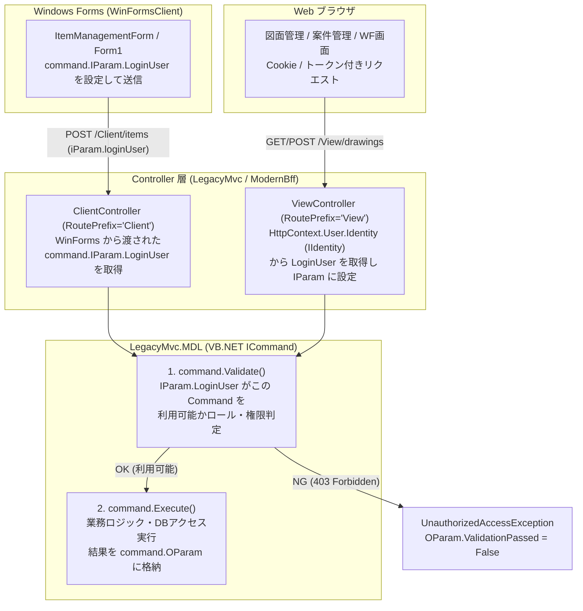
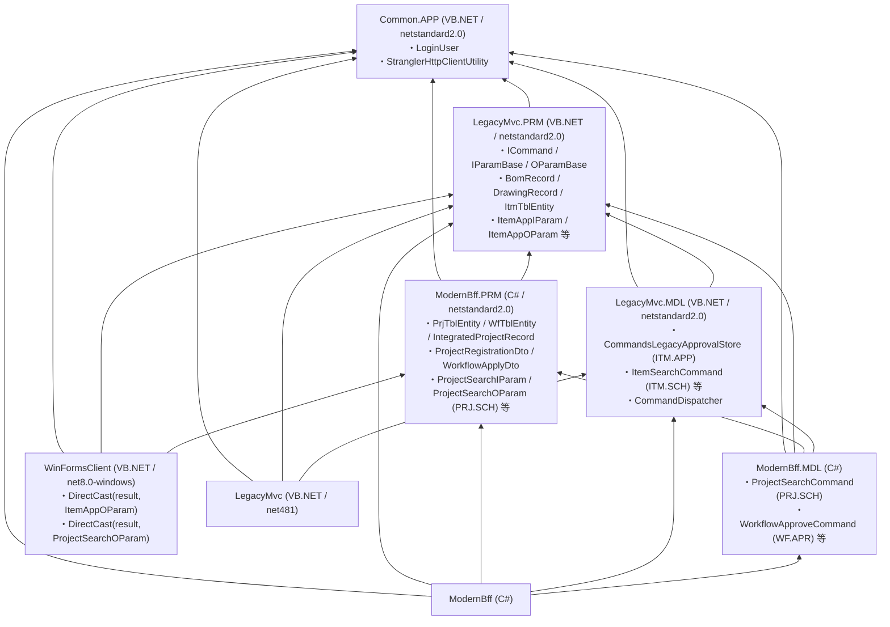

# LegacyMvc.MDL の `ICommand` (`IParamBase` / `OParamBase`) 認可・実行機構と `ModernBff` 移行時の要否整理

本ドキュメントでは、レガシー側 (`LegacyMvc` / `LegacyMvc.MDL`) で採用されている **`ICommand` インターフェースによるコマンド実行・利用可否判定の仕組み**の実装内容と、それを **`ModernBff` へ移行（Strangler Fig パターン）する際に「何が不要になり、何をそのまま活かせるか」**を整理します。

---

## 1. 実装した `ICommand` / `IParamBase` / `OParamBase` の構成 (`LegacyMvc.MDL`)

実装ファイル: [`LegacyMvc.MDL/Commands/ICommandFramework.vb`](file:///e:/MyJobs/VisualStudio/web/LegacyMvc.MDL/Commands/ICommandFramework.vb)

### 1.1 `ICommand` インターフェース定義 (VB.NET)

```vb
Public Interface ICommand
    ReadOnly Property IParam() As IParamBase
    ReadOnly Property OParam() As OParamBase
    Property ResponseType() As String
    Sub Execute()
    Sub Validate()
End Interface
```

### 1.2 `IParamBase` と `OParamBase` の役割

* **`IParamBase` ([`ICommandFramework.vb`](file:///e:/MyJobs/VisualStudio/web/LegacyMvc.MDL/Commands/ICommandFramework.vb#L38-L60))**
  * `SessionId` / `SessionData`: レガシー側の ASP.NET `HttpSessionState` のセッション情報を保持します。
  * `LoginUser` (`CommandLoginUser`): コマンドを実行するログインユーザ情報（ユーザID、氏名、組織、ロール一覧、取得経路 `SourceChannel`）を保持します。
  * `CommandId`: 実行対象のコマンド識別子を保持します。
* **`OParamBase` ([`ICommandFramework.vb`](file:///e:/MyJobs/VisualStudio/web/LegacyMvc.MDL/Commands/ICommandFramework.vb#L65-L76))**
  * `ValidationPassed`: `Validate()` によるコマンド利用可否チェック結果 (`True` / `False`)。
  * `PermissionCheckResult`: 認可判定の詳細メッセージ（どの経路のどのユーザに対して許可／拒否されたか）。
  * `IsSuccess` / `ExecutedAtUtc`: `Execute()` の実行結果ステータス。

### 1.3 実装済みの具体コマンドクラス (`LegacyMvc.MDL.Commands`)

| コマンドクラス | 入力 (`IParam`) | 出力 (`OParam`) | 主な呼び出し元 |
| :--- | :--- | :--- | :--- |
| [`ItemSearchCommand`](file:///e:/MyJobs/VisualStudio/web/LegacyMvc.MDL/Commands/ICommandFramework.vb#L186-L200) | `ItemSearchIParam` | `ItemSearchOParam` | `ClientController` (`GET /Client/items`) |
| [`ItemSaveCommand`](file:///e:/MyJobs/VisualStudio/web/LegacyMvc.MDL/Commands/ICommandFramework.vb#L223-L250) | `ItemSaveIParam` | `ItemSaveOParam` | `ClientController` (`POST /Client/items`) |
| [`CustomerQueryCommand`](file:///e:/MyJobs/VisualStudio/web/LegacyMvc.MDL/Commands/ICommandFramework.vb#L329-L343) | `CustomerQueryIParam` | `CustomerQueryOParam` | `ClientController` (`GET /Client/customer/{id}`) |
| [`DrawingSearchCommand`](file:///e:/MyJobs/VisualStudio/web/LegacyMvc.MDL/Commands/ICommandFramework.vb#L265-L279) | `DrawingSearchIParam` | `DrawingSearchOParam` | `ViewController` (`GET /View/drawings`) |
| [`DrawingSaveCommand`](file:///e:/MyJobs/VisualStudio/web/LegacyMvc.MDL/Commands/ICommandFramework.vb#L298-L325) | `DrawingSaveIParam` | `DrawingSaveOParam` | `ViewController` (`POST /View/drawings`) |

---

## 2. `ViewController` と `ClientController` における `LoginUser` 設定とコマンド利用可否判定

レガシー側 ([`LegacyMvc/Controllers/ClientAndViewControllers.vb`](file:///e:/MyJobs/VisualStudio/web/LegacyMvc/Controllers/ClientAndViewControllers.vb)) およびモダン側 ([`ModernBff/Controllers/ClientController.cs`](file:///e:/MyJobs/VisualStudio/web/ModernBff/Controllers/ClientController.cs), [`ModernBff/Controllers/ViewController.cs`](file:///e:/MyJobs/VisualStudio/web/ModernBff/Controllers/ViewController.cs)) の双方で以下の動作を確認できます。



### 動作確認用のエンドポイント（`WinFormsClient` のコンボボックスからすぐテスト可能）
* **正常系（コマンド利用可能）**:
  * `/Client/items` （`ClientController` → `ItemSearchCommand.Validate()` OK → `Execute()`）
  * `/View/drawings` （`ViewController` → `IIdentity` から `LoginUser` 設定 → `DrawingSearchCommand.Validate()` OK → `Execute()`）
  * `/legacy-api/Client/items` / `/legacy-api/View/drawings` （`LegacyMvc` 側での直接実行）
* **異常系（コマンド利用不可・403 Forbidden 確認用）**:
  * `/Client/items?loginUserId=blocked`
  * `/View/drawings?loginUserId=blocked`
  * `/legacy-api/Client/items?loginUserId=blocked`
  * `/legacy-api/View/drawings?loginUserId=blocked`

---

## 3. `ModernBff` の実装により「不要になるもの」と「残すべき（再利用できる）もの」

結論として、**コントローラー層での「クライアント自己申告の `IParam.LoginUser` 受け取り」や「`Session` オブジェクトの引き回し」は `ModernBff` により不要になります**。一方で、**`LegacyMvc.MDL` 内の `ICommand`（`Validate` / `Execute`）という業務コマンド構造自体はそのまま再利用可能**です。

### 3.1 `ModernBff` 化によって【不要になる仕組み】（廃止・簡素化できるもの）

| レガシーの仕組み | `ModernBff` で不要になる理由 | `ModernBff` での代替手段 |
| :--- | :--- | :--- |
| **① Windows Forms から `command.IParam.LoginUser` を毎回リクエストに詰めて送信する仕組み** | **【セキュリティ向上＆二重管理解消】**<br>レガシーでは WinForms と Web で認証が分かれていたため、WinForms 側が保持する `LoginUser` をリクエスト (`IParam.LoginUser`) に詰めて `ClientController` に渡していました。しかしこの方式はクライアント側で `LoginUser` を書き換えて送信できる（なりすまし可能）という弱点があります。<br>`ModernBff` では WinForms も `WebView2` を通じて Web と同じ認証（`USR_TBL` / OIDC / SAML）を行い、共通のセッショントークン (`X-Strangler-AuthToken` / Cookie) を持ちます。 | `ClientController` でも `ViewController` と全く同じく、**サーバー側（Redis 共有セッション / `HttpContext.User.Identity`）から信頼できる `LoginUser` を自動取得**できます。WinForms 側で `IParam.LoginUser` を手動構築して送るコードは不要になります。 |
| **② `ViewController` と `ClientController` で `LoginUser` の取得ロジックを別々に書く仕組み** | レガシーでは「ブラウザは `IIdentity`」「WinForms は `IParam.LoginUser`」と取得元が異なっていましたが、`ModernBff` では両者とも同じトークン／Cookie でアクセスしてきます。 | ASP.NET Core の認証ミドルウェア（または共通ヘルパー）で一度だけ `ClaimsPrincipal` (`IIdentity`) を復元すれば、`ViewController` も `ClientController` も同一の `User.Identity` を参照するだけで済みます。 |
| **③ `IParamBase` に ASP.NET `Session` (`HttpSessionState`) を丸ごと持たせる仕組み** | レガシーでは画面間の状態保持やユーザ情報の引き回しにインプロセス `Session` を多用していましたが、スケールアウトや新旧共存の妨げになります。 | 認証・ユーザ情報は **Redis 共有セッション (`SharedLoginUserStore`)** に集約し、業務データは DB / リクエストパラメータでステートレスに渡すため、重い `Session` 辞書の引き回しは不要になります。 |
| **④ 各 Controller アクション内での手動の `Validate()` 呼び出しボイラープレート** | レガシーではすべてのアクションメソッド内で手動で `LoginUser` を詰めて `cmd.Validate()` を呼ぶ必要がありました。 | 新規開発する `ModernBff.MDL` のコマンドやエンドポイントでは、ASP.NET Core 標準の `[Authorize(Roles = "...")]` 属性や `ActionFilter` / ミドルウェアで横断的に認可を行えます。 |

---

### 3.2 `ModernBff` 化しても【そのまま活かせる（作り直さなくてよい）仕組み】

* **`LegacyMvc.MDL` (VB.NET) 内の `ICommand` / `IParamBase` / `OParamBase` 実装クラス群**
  * 既存の膨大な業務コマンド（`Validate()` の業務固有の権限・状態チェックや、`Execute()` の DB 処理）を、モダン化のためにすべて C# へ書き直す必要はありません。
  * [`ModernBff/Controllers/ClientController.cs`](file:///e:/MyJobs/VisualStudio/web/ModernBff/Controllers/ClientController.cs) や [`ModernBff/Controllers/ViewController.cs`](file:///e:/MyJobs/VisualStudio/web/ModernBff/Controllers/ViewController.cs) で実装した通り、`ModernBff` 側で **Redis / `IIdentity` から復元した `LoginUser` を `cmd.IParam.LoginUser` にセットして `cmd.Validate()` → `cmd.Execute()` を呼び出す**だけで、`LegacyMvc.MDL` の既存コマンド資産を無改修で安全に再利用できます。

---

## 4. まとめ：移行ステップの推奨方針

1. **フェーズ1（現在の実装状態：新旧完全互換）**
   * `LegacyMvc.MDL` の `ICommand` (`IParamBase` / `OParamBase` / `Validate` / `Execute`) はそのまま維持する。
   * `ClientController` は WinForms から送られた `command.IParam.LoginUser` も受け取れるようにしつつ、トークンがあれば Redis からサーバー側で自動補完できるようにする。
2. **フェーズ2（WinForms 側のスリム化）**
   * WinForms (`WebView2` ログイン済み) からはセッショントークン (`X-Strangler-AuthToken`) のみを自動送信し、WinForms 側で毎回 `command.IParam.LoginUser` をセットするコードを削除する（サーバー側でトークンから `IParam.LoginUser` を設定して `cmd.Validate()` を実行する）。
3. **フェーズ3（新規機能の `ModernBff.MDL` 実装）**
   * 案件統合管理やワークフローなど `ModernBff.MDL` で新規に作る機能は、`IParamBase` に `Session` を持たせるレガシー方式は使わず、ステートレスな DTO + EF Core + 共通ログインユーザ (`SharedLoginUser`) でシンプルに実装する。

---

## 5. コマンド名指定ディスパッチ（`<command name="ITM.APP" ...>`）は BFF 移行後も同じ仕組みがよいか？もっと良い別案があるか？

### 結論
* **既存資産（WinForms や既存の `LegacyMvc.MDL` コマンド群）を無改修または最小改修で動かす目的であれば、BFF 移行後も同じコマンド名ディスパッチ窓口（`POST /Client/execute`・`POST /View/execute`）を残すのが非常に有効**です。
* ただし、レガシーの **「Config（XML/JSON）に文字列でクラス名・アセンブリ名を手書きし、毎回リフレクション（`Activator.CreateInstance`）で生成する仕組み」には保守上の弱点がある**ため、BFF では以下の **【改善案1：属性自動登録＋ハイブリッドディスパッチャ】** および **【改善案2：新機能向けの型付きエンドポイント / MediatR パターン】** を組み合わせるのがベストプラクティスです。

| 比較項目 | ① 従来方式：Config 文字列マッピング<br>`<command name="ITM.APP" command="...,LegacyMvc.MDL" db="1">` | ② 【改善案1（既存コマンド向け推奨）】<br>`<CommandDefinition("ITM.APP", Db:=1)>` 属性による自動検出＋DI | ③ 【改善案2（モダン新規画面向け推奨）】<br>機能別 REST/BFF エンドポイント（または MediatR） |
| :--- | :--- | :--- | :--- |
| **仕組み** | Config ファイルにコマンド名と型名を列挙し、`Type.GetType` で動的生成 | コマンドクラス自身に `<CommandDefinition("ITM.APP", Db:=1)>` を付与し、起動時にアセンブリスキャンで自動登録 | `/api/bff/workflow/approve` のように URL と HTTP メソッドで表現 |
| **メリット** | ・既存の WinForms 呼び出しコード（`"ITM.APP"` 指定）を **1行も変えずに BFF へ移行可能** | ・**Config の記述漏れ・タイポ（実行時 `TypeLoadException`）がゼロになる**<br>・クラス名変更時にリファクタリングが効く<br>・WinForms 側の `"ITM.APP"` 呼び出し互換性も **100% 維持** | ・OpenAPI (Swagger) や MCP ツール定義が自動生成できる<br>・ブラウザ開発者ツール（Network タブ）でどの処理が呼ばれたか一目で分かる |
| **デメリット** | ・クラス名変更や追加時に Config 文字列との二重管理が発生し、実行時までミスに気づけない | ・単一エンドポイント (`/Client/execute`) になるため、URL だけでは業務内容が見えにくい | ・既存の WinForms 通信ユーティリティ（コマンド名指定方式）からは呼び出し方の変更が必要 |

> [!TIP]
> **本ソリューションでの実装（ハイブリッド方式）**
> [`CommandDispatcher`](file:///e:/MyJobs/VisualStudio/web/LegacyMvc.MDL/Commands/ICommandFramework.vb#L322-L401) では、**① Config（`Web.config` 相当の `<command name="ITM.APP" command="LegacyMvc.MDL.CommandsLegacyApprovalStore,LegacyMvc.MDL" db="1">`）による登録** と、**② `<CommandDefinition("ITM.APP", Db:=1)>` 属性による自動検出** の両方に対応しています。

---

## 6. 共通プロジェクト構成（`Common.APP` / `LegacyMvc.PRM` / `ModernBff.PRM`）と `DirectCast` の仕組み

循環参照を防ぎつつ、レガシー側・モダン側で完全に対称な構成（`Controller` → `MDL` → `PRM` → `Common.APP`）となるよう分割しています。



### `WinFormsClient` での `DirectCast` コード例 ([`Form1.vb`](file:///e:/MyJobs/VisualStudio/web/WinFormsClient/Form1.vb#L268-L283))
```vb
Dim iParam As New ItemAppIParam() With {
    .CommandId = "ITM.APP",
    .TargetItmCd = "ITM-001",
    .TargetBomNo = "BOM-2026-001",
    .TargetDrawingNo = "drw004",
    .ActionMode = "QUERY_AND_APPROVE"
}

' Common.APP.StranglerHttpClientUtility で "ITM.APP" を送信し、
' 返却された OParam を LegacyMvc.PRM.ItemAppOParam に DirectCast (Option Strict On 対応)
Dim rawOParam As Object = Await HttpUtil.ExecuteCommandAsync("ITM.APP", iParam, "Client/execute")
Dim oParam As ItemAppOParam = DirectCast(rawOParam, ItemAppOParam)
```

