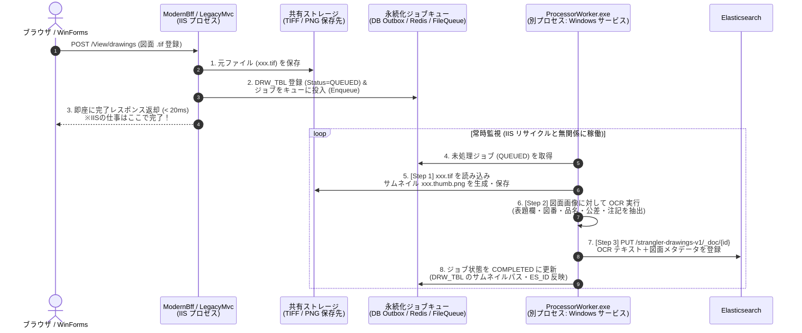

# 図面登録時の非同期パイプライン（TIFF→PNG サムネイル生成・OCR・Elasticsearch 登録）と IIS 分離設計ガイド

本ドキュメントでは、図面登録時に発生する **「① `.tif` からサムネイル用 `.png` 生成」「② OCR 解析」「③ Elasticsearch への全文検索インデックス登録」** を、`ModernBff` / `LegacyMvc`（IIS・Web プロセス）から切り離して別プロセスとして実装する方法と、**IIS から分離すべき処理の判断基準・一覧**をまとめます。

---

## 1. なぜ IIS / Web プロセス (`ModernBff` / `LegacyMvc`) 内で実行してはいけないのか？

IIS（または Web API ホスト）の HTTP リクエスト処理内、あるいは Web プロセス内の `Task.Run`（インプロセス・ファイア＆フォーゲット）で OCR や画像変換を実行すると、以下の致命的な問題が発生します。

1. **IIS アプリケーションプールのリサイクルによる強制切断（データ欠損）**
   * IIS は既定で **29時間ごとの定期リサイクル**、設定変更時、メモリ閾値超過時、アイドルタイムアウト時にワーカープロセス (`w3wp.exe`) を再起動します。
   * Web プロセス内で `Task.Run` で裏で OCR や `.tif` → `.png` 変換を走らせていると、リサイクル時にスレッドが強制終了され、**「DB には図面が登録されているのに、サムネイルが存在せず Elasticsearch にも登録されていない（検索にヒットしない）」** という中途半端な不整合状態になります。
2. **CPU・メモリ枯渇による Web 画面全体のレスポンス悪化**
   * 大判 CAD 図面（A0/A1 マルチページ TIFF, G4 圧縮）のデコードや OCR は、1枚で数百MB〜数GBのアンマネージドメモリと 100% 近い CPU を数秒〜数十秒消費します。Web プロセスと同居させると、他ユーザの画面遷移やログイン処理までハングアップします。
3. **アンマネージド DLL（画像処理・OCR エンジン）のメモリリーク影響**
   * LibTiff / SkiaSharp / Magick.NET / Tesseract OCR 等のネイティブライブラリが万一クラッシュやメモリ断片化を起こしても、別プロセスであれば Web サイト自体を巻き込んでダウンさせることがありません。

---

## 2. どのように実装すべきか？（推奨アーキテクチャ）

### 全体構成：Producer-Consumer（Outbox キュー ＋ 独立 Worker サービス）

Web サーバー（IIS / `ModernBff`）は **「ファイル保存＋DB登録＋ジョブキューへの投入（Enqueue）」だけを行って即座（数ミリ秒）にブラウザへ応答**し、別プロセスである **[`ProcessorWorker`](file:///e:/MyJobs/VisualStudio/web/ProcessorWorker/Program.cs)**（Windows サービス）がキューから非同期に取り出して処理します。

### 実装の3つの要諦

| 構成要素 | 推奨する実装方式 | 本ソリューションでの実装箇所 |
| :--- | :--- | :--- |
| **① 別プロセスのホスティング方式** | **`.NET Worker Service` (`BackgroundService`) + `UseWindowsService()`** ・IIS とは完全に独立した実行ファイル (`ProcessorWorker.exe`) としてビルドし、OS の **Windows サービス**（または別サーバー／コンテナ）として常駐起動させます。 ・IIS が何度リサイクルされても `ProcessorWorker.exe` は一切影響を受けません。 | [`ProcessorWorker/ProcessorWorker.csproj`](file:///e:/MyJobs/VisualStudio/web/ProcessorWorker/ProcessorWorker.csproj) [`ProcessorWorker/Program.cs`](file:///e:/MyJobs/VisualStudio/web/ProcessorWorker/Program.cs) |
| **② プロセス間連携（キューの永続化）** | **DB Transactional Outbox テーブル** または **Redis Streams / 永続化ファイルキュー** ・最も堅牢なのは、図面テーブル (`DRW_TBL`) と同じ DB トランザクション内で `DRW_JOB_QUEUE_TBL` に `STATUS='QUEUED'` で `INSERT` する **Transactional Outbox パターン**（＋高速通知用に Redis Pub/Sub 併用）です。 ・これにより「DB登録は成功したがキュー投入に失敗する」不整合が100%防げます。 | [`LegacyMvc.PRM/ParameterModels.vb`](file:///e:/MyJobs/VisualStudio/web/LegacyMvc.PRM/ParameterModels.vb#L118-L142) (`DrawingBackgroundJobRecord`) [`LegacyMvc.MDL/Commands/LegacyApprovalCommands.vb`](file:///e:/MyJobs/VisualStudio/web/LegacyMvc.MDL/Commands/LegacyApprovalCommands.vb#L202-L315) (`DrawingOutboxQueueStore`) |
| **③ 冪等性（Idempotency）と Graceful Shutdown** | ・**Graceful Shutdown**: `ExecuteAsync(CancellationToken stoppingToken)` で `stoppingToken` を監視し、Windows サービス自体を再起動する際も「現在処理中の1枚のOCR・ES登録が完了するまで待ってからプロセスを終了」させます。 ・**冪等性**: サムネイル PNG の上書き保存や Elasticsearch の `PUT /{index}/_doc/{drawingNo}`（ドキュメントIDを図面番号に固定）により、万一リトライで2回実行されても重複登録になりません。 | [`ProcessorWorker/Program.cs`](file:///e:/MyJobs/VisualStudio/web/ProcessorWorker/Program.cs#L43-L81) |

---

## 3. IIS（Web プロセス）とは切り離すべき処理の一覧と分類

今回の「TIFF→PNG サムネイル生成」「OCR」「Elasticsearch 登録」を含め、業務システムにおいて **IIS（Web アプリケーション）から別プロセス (`Worker Service`) へ切り離すべき処理**は以下の 5 カテゴリに分類されます。

| カテゴリ | 具体例（図面・品目・案件管理システムにおける例） | IIS から切り離すべき理由 |
| :--- | :--- | :--- |
| **① 画像・CAD・メディア変換処理** *(CPU・メモリ・GDI+ 負荷)* | ・**`.tif` (マルチページ/G4圧縮) からのサムネイル用 `.png` 生成** ・CAD ファイル (`.dwg` / `.dxf` / `.step`) から閲覧用 PDF / SVG / 3D 軽量モデルへの変換 ・**ワークフロー最終承認時の「承認印（電子スタンプ）・透かし（Watermark）」の図面 PDF/TIFF への焼き込み処理** | ・1ファイルあたり数十MB〜数百MBのメモリを消費し、ネイティブ画像ライブラリ（SkiaSharp, ImageMagick, ODA 等）が CPU を占有するため、IIS 内で動かすと Web 全体がフリーズする。 |
| **② AI・OCR・全文検索インデックス作成** *(長時間処理・外部エンジン通信)* | ・**図面画像・PDF に対する OCR テキスト抽出**（表題欄・部品番号・注記の読み取り） ・**Elasticsearch / OpenSearch へのドキュメント登録・再インデックス (Reindex)** ・MCP / RAG 検索用のベクトル埋め込み（Embedding）生成処理 | ・処理時間が数秒〜数分に及び、HTTP タイムアウトや IIS リサイクルによる途中切断が最も起きやすい。 |
| **③ 大容量ファイルの入出力・帳票生成** *(I/O・長時間バッチ)* | ・**案件に紐づく全図面（数十〜数百枚の `.tif` / `.pdf`）の一括 ZIP 圧縮パッケージ作成** ・数万件規模の品目マスタ (`ITM_TBL`) / BOM の Excel・CSV 一括インポート＆バリデーション ・複雑な見積書・承認完了報告書 PDF の一括生成 | ・ブラウザを待機させるとタイムアウトするため、「ジョブ受付 → Worker で ZIP/PDF 生成 → 完了通知（Windows 通知／メール）→ ダウンロードリンク提供」の非同期型にするべき。 |
| **④ 外部システム連携・通知の確実な配送** *(ネットワーク障害耐性・リトライ)* | ・**ワークフロー完了時のメール送信（SMTP / SendGrid 等）** ・基幹 ERP / 生産管理システムへの承認済み品目・BOM 連携 API 送信 ・Teams / Slack / Webhook 通知 | ・外部メールサーバーや ERP が一時的に瞬断・高負荷だった場合、IIS リクエスト内で同期実行しているとエラーまたは長時間待機になる。Outbox キュー＋Worker にすれば指数バックオフで自動リトライできる。 |
| **⑤ 定期実行・夜間バッチ・メンテナンス** *(スケジュール実行)* | ・IdP (Entra ID / 人事マスタ) からのユーザ・組織 (`USR_TBL`) 日次同期 ・一時アップロードファイルや期限切れトークンのクリーンアップ ・Elasticsearch と RDB (`DRW_TBL`) の差分整合性チェック | ・IIS は「アクセスがないとスリープ（アイドルシャットダウン）する」性質があるため、cron やタイマーによる定期実行を IIS 内に実装すると指定時刻に動かないことがある。 |

---

## 4. 設計判断のシンプルな基準（ルール・オブ・サム）

今後、新しい機能を追加する際は、以下の **3つの質問のうち1つでも YES なら `DrawingProcessorWorker`（別プロセス Worker）側に実装**してください。

1. **処理時間が 1〜2 秒を超える可能性があるか？**（OCR、画像変換、大容量ZIP/Excel）
2. **IIS が途中でリサイクル・再起動したときに、処理が中断されると困るか？**（Elasticsearch 登録、承認スタンプ焼き込み、外部 ERP 連携）
3. **CPU・メモリ（特に画像・PDF・CAD のネイティブメモリ）を大量に使うか？**（`.tif` → `.png` 変換）

---

## 5. 本ソリューションでの動作確認方法

1. **別プロセス Worker の起動**
   * `ProcessorWorker` プロジェクト（`dotnet run --project ProcessorWorker`、または Windows サービス登録）を起動すると、IIS / `ModernBff` とは別プロセスでキュー監視を開始します。
2. **図面登録からの非同期ジョブ確認**
   * ブラウザの図面管理画面 (`/legacy-drawings`) または `POST /View/drawings` で図面を登録すると、即座に `QUEUED` としてジョブが生成されます。
   * `WinFormsClient` のコンボボックスに追加した **`/View/drawings/jobs?processNow=true`** を実行（または `ProcessorWorker` プロセスを稼働）すると、**[Step 1] `.tif` → `.thumb.png` 生成 → [Step 2] OCR 抽出 → [Step 3] Elasticsearch インデックス登録** の全ステップの実行ログと結果を確認できます。
