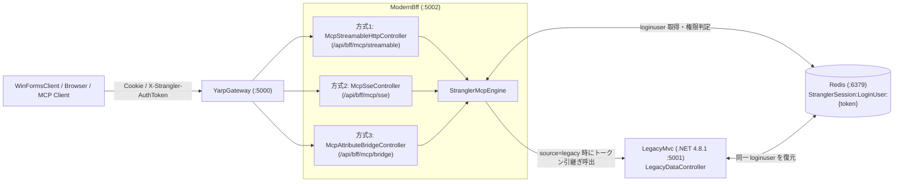

# MCP (Model Context Protocol) コントローラー実装方式の比較ガイド

本ドキュメントでは、`ModernBff` プロジェクトに実装した **3種類の MCP (Model Context Protocol) コントローラー実装方式** のアーキテクチャ、リクエスト/レスポンス構造、メリット・デメリット、およびストラングラー・フィグ（Strangler Fig）移行における使い分けを解説します。

---

## 1. 全体アーキテクチャと `loginuser` 共有の仕組み

3つの MCP コントローラーはすべて `YarpGateway` (`/api/bff/mcp/*`) 経由でアクセスでき、共通エンジン [`StranglerMcpEngine`](ModernBff/Mcp/StranglerMcpEngine.cs) と [`SharedLoginUserStore`](ModernBff/Services/SharedLoginUserStore.cs) を通じて、Redis 上の共有セッション `loginuser`（ユーザID・氏名・組織コード・組織名・権限ロール）を自動認識します。



---

## 2. 3つの実装方式の比較一覧表

| 比較項目 | 方式1: Streamable HTTP JSON-RPC 方式 | 方式2: HTTP + SSE (Server-Sent Events) 方式 | 方式3: Attribute / Reflection 自動公開・REST ブリッジ方式 |
| :--- | :--- | :--- | :--- |
| **実装クラス** | [`McpStreamableHttpController.cs`](ModernBff/Controllers/Mcp/McpStreamableHttpController.cs) | [`McpSseController.cs`](ModernBff/Controllers/Mcp/McpSseController.cs) | [`McpAttributeBridgeController.cs`](ModernBff/Controllers/Mcp/McpAttributeBridgeController.cs) |
| **準拠仕様・モデル** | **MCP 2025-03-26** (Streamable HTTP 最新標準) | **MCP 2024-11-05** (HTTP + SSE 従来標準) | C# カスタム属性 (`[McpTool]`) + リフレクション自動公開 |
| **主要エンドポイント** | `POST /api/bff/mcp/streamable`<br>`GET /api/bff/mcp/streamable` (動作確認用) | `GET /api/bff/mcp/sse` (ストリーム確立)<br>`POST /api/bff/mcp/sse/message` | `GET /api/bff/mcp/bridge/compare`<br>`GET /api/bff/mcp/bridge/invoke/{toolName}` |
| **通信プロトコル** | 単一 HTTP エンドポイント上の JSON-RPC 2.0 | `text/event-stream` (SSE) + HTTP POST | REST (GET/POST) + メソッド属性ディスパッチ |
| **YARP (リバースプロキシ) 相性** | **◎ 最適**（通常のステートレス HTTP として中継可能） | **△ 要設定**（バッファリング無効化・長寿命接続維持が必要） | **◎ 最適**（通常の REST API と完全同一） |
| **スケールアウト (複数台構成)** | **◎ 容易**（ステートレス。Redis で `loginuser` 共有のみ） | **△ 工夫が必要**（`sessionId` のスティッキーセッションまたは Redis Pub/Sub が必要） | **◎ 容易**（完全ステートレス） |
| **既存業務 API からの移行容易性** | ○（JSON-RPC ハンドラへのマッピングを記述） | △（非同期ストリーム管理の実装が必要） | **◎ 最速**（既存メソッドに `[McpTool]` 属性を貼るだけ） |
| **推奨ユースケース** | ・新規構築する本番 MCP サーバー<br>・YARP ゲートウェイ配下でのマイクロサービス運用 | ・長時間処理の進捗プッシュ通知が必要な場合<br>・SSE 専用の旧世代 MCP クライアント接続 | ・既存の Controller / Service 資産を素早く AI ツール化したい場合<br>・WinForms 等から手軽に呼び出したい場合 |

---

## 3. 各実装方式の詳細解説

### 方式1: Streamable HTTP JSON-RPC 方式 (`McpStreamableHttpController`)

* **実装ファイル**: [`ModernBff/Controllers/Mcp/McpStreamableHttpController.cs`](ModernBff/Controllers/Mcp/McpStreamableHttpController.cs)
* **概要**:
  MCP 2025-03-26 仕様で策定された最新の標準トランスポート方式です。従来の SSE のように「受信用ストリーム接続」と「送信用 POST エンドポイント」を分離せず、単一の `/api/bff/mcp/streamable` エンドポイントに対する `POST` で JSON-RPC 2.0 メッセージ（`initialize`, `tools/list`, `tools/call`）を送受信します。
* **メリット**:
  * ステートレスな HTTP リクエストとして完結するため、`YarpGateway` でのルーティング、ロードバランシング、認証ヘッダー中継が最もシンプルに行えます。
* **リクエスト例 (`POST /api/bff/mcp/streamable`)**:
  ```json
  {
    "jsonrpc": "2.0",
    "id": "req-01",
    "method": "tools/call",
    "params": {
      "name": "get_customer_strangler",
      "arguments": {
        "customerId": 1,
        "source": "modern"
      }
    }
  }
  ```
* **簡易動作確認 (`GET`)**:
  ブラウザや `WinFormsClient` から引数なしで手軽に試せるよう、`GET /api/bff/mcp/streamable?tool=get_customer_strangler&source=modern` にアクセスすると、内部で JSON-RPC リクエストをシミュレート実行した結果を返します。

---

### 方式2: HTTP + SSE (Server-Sent Events) 双方向ストリーム方式 (`McpSseController`)

* **実装ファイル**: [`ModernBff/Controllers/Mcp/McpSseController.cs`](ModernBff/Controllers/Mcp/McpSseController.cs)
* **概要**:
  MCP 2024-11-05 仕様で広く使われている `text/event-stream` ベースの方式です。
  1. クライアントが `GET /api/bff/mcp/sse` に接続すると、サーバーは最初に `event: endpoint` としてメッセージ送信先 URL (`/api/bff/mcp/sse/message?sessionId=xxx`) をプッシュ通知します。
  2. クライアントがその URL に JSON-RPC を `POST` すると、結果が SSE ストリーム上の `event: message` として流れてきます。
* **メリット**:
  * サーバー主導のイベントプッシュ（重いバッチ処理の進捗通知やログの逐次ストリーミングなど）に適しています。
* **注意点**:
  * YARP や Nginx 等のリバースプロキシを経由する場合、`X-Accel-Buffering: no` や `Cache-Control: no-cache` を付与してレスポンスバッファリングを無効化する必要があります（`McpSseController` 内で設定済み）。
* **ストリーム出力イメージ (`GET /api/bff/mcp/sse?oneShot=true&customerId=1`)**:
  ```text
  event: endpoint
  data: /api/bff/mcp/sse/message?sessionId=8f9d2a...

  event: message
  data: {"jsonrpc":"2.0","id":1,"result":{"protocolVersion":"2025-03-26",...}}

  event: message
  data: {"jsonrpc":"2.0","id":2,"result":{"implementationStyle":"方式2: HTTP + SSE...", ...}}
  ```
  ※ `oneShot=true`（デフォルト）では一連のイベント送出後にストリームを完了するため、`WinFormsClient` のテキストボックスでもハングアップせずに全ストリーム内容を確認できます。長寿命接続を維持する場合は `oneShot=false` を指定します。

---

### 方式3: Attribute / Reflection 自動公開・REST ブリッジ方式 (`McpAttributeBridgeController`)

* **実装ファイル**: [`ModernBff/Controllers/Mcp/McpAttributeBridgeController.cs`](ModernBff/Controllers/Mcp/McpAttributeBridgeController.cs)
* **概要**:
  C# のカスタム属性 `[McpTool("ツール名", "説明")]` と `[Description("引数説明")]` をメソッドに付与し、リフレクションによって **MCP ツール定義スキーマの自動生成** と **メソッドの動的ディスパッチ実行** を行う方式です（Semantic Kernel の `[KernelFunction]` や公式 C# SDK の `[McpServerTool]` と同じアプローチです）。
* **コード記述イメージ**:
  ```csharp
  [McpTool("check_permission", "共有 loginuser の組織と権限ロールを検証し、アクセス権限を判定します。")]
  [NonAction]
  public object CheckUserPermissionTool(
      [Description("対象顧客ID")] int customerId,
      LoginUser? loginUser,
      string loginSource)
  {
      // loginuser の組織・ロール (Admin, CustomerWrite, LegacyAccess 等) を判定して返却
  }
  ```
* **メリット**:
  * 既存の業務ロジックや BFF サービスメソッドに属性を1行追加するだけで MCP ツールとして公開でき、ボイラープレートコードを最小化できます。
  * `GET /api/bff/mcp/bridge/compare` で自動検出されたツール一覧と3方式の比較マトリクスを確認でき、`GET /api/bff/mcp/bridge/invoke/check_permission?customerId=1` で直接ツールを実行できます。

---

## 4. 結論：ストラングラー・フィグ移行ではどの方式を選ぶべきか？

1. **外部の標準 MCP クライアント（AI エージェント等）との通信インターフェース**としては、YARP リバースプロキシとの親和性が高くステートレスにスケールできる **「方式1: Streamable HTTP JSON-RPC 方式 (`McpStreamableHttpController`)」** をメインのトランスポートとして採用するのが推奨です。
2. **サーバー内部でのツールの実装・管理方法**としては、メソッドが増えるたびに switch 文を書くのを避けるため、**「方式3: Attribute / Reflection 方式 (`[McpTool]`)」** の仕組みを組み合わせて、属性付きメソッドを自動的に `tools/list` / `tools/call` へ登録するハイブリッド構成にするのが最も保守性に優れています。
